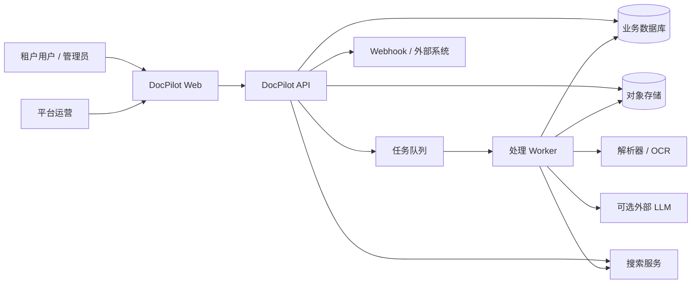

# 概要设计说明（系统架构）

| 属性 | 内容 |
|---|---|
| 文档编号 | DOC-ARCH-001 |
| 版本 / 状态 | 0.3 / 阶段 B（授权与审计）与阶段 D（复核、文档库、导出）增补 |
| 日期 | 2026-10-02 |
| 编写依据 | 参考 ISO/IEC/IEEE 42010:2022 架构描述观点 |

## 1. 架构目标与约束

目标是从当前单进程演示应用演进到可运营的多租户 SaaS。首要架构关切是租户隔离、文档隐私、任务可靠性、可扩展处理器、检索可追溯、可维护迁移和可观测性。

现有技术：FastAPI/Python、Vue 3/TypeScript/Vite、PyMuPDF、RapidOCR、openpyxl、进程内 JobManager。目标架构中的 PostgreSQL、对象存储和持久化队列为建议，需 ADR 确认后再实现。

基础工程当前已落地 SQLAlchemy/Alembic、SQLite 本地数据库、账号/租户/会话模型、按租户持久化处理任务快照及认证版 `/api/v1/tenants/{tenant_id}/jobs`。本地文件仍落在 `uploads/<tenant_id>/<job_id>`；PostgreSQL 连接驱动已纳入依赖但尚未验证。独立对象存储和分布式队列仍是后续工作。

当前受保护任务路由已统一为 `/api/v1/tenants/{tenant_id}/jobs`。`tenant_id` 来自路径但每次都需通过会话成员关系授权；生产环境禁止 SQLite 并要求部署前运行迁移。FastAPI 在生产环境只托管已构建的 `frontend/dist`，否则返回 503。

授权与审计的现状缺口是阶段 B 的收尾项：`Membership.role` 与 `User.is_platform_admin` 已入库但从未参与任何判定，所有 active 成员事实上拥有全部权限；不存在邀请实体，也不存在审计事件表。本期按 DOC-DD-003 引入服务端角色矩阵、一次性邀请令牌和只追加审计事件。

## 2. 系统上下文

外部 OCR/LLM、邮件/网盘、客户系统均为数据处理边界；启用前需确定合同、数据位置、保留策略及失败行为。

## 3. 容器与模块视图

| 模块 | 职责 | 当前代码映射 / 目标 |
|---|---|---|
| Web UI | 登录、租户切换、模板、上传、复核、搜索和管理 | 当前 `frontend/src` 有上传和结果页；目标补齐身份/复核/管理 |
| API/BFF | 认证、租户上下文、授权、校验、版本化接口 | 当前 `app/api/routes.py` 负责任务 API；目标将业务服务/身份授权分层 |
| 授权策略 | 角色矩阵判定、成员关系读取、默认拒绝 | 当前角色字段已存但未参与判定；本期在 `app/api/dependencies.py` 增加角色依赖 |
| 成员与邀请服务 | 成员列表/角色变更/移除、邀请创建/撤销/接受 | 当前不存在，本期新增 `app/services/membership.py` |
| 审计事件 | 只追加记录授权变更与敏感数据操作 | 当前不存在，本期新增 `app/services/audit.py` |
| 文档服务 | 文档元数据、版本、标签、生命周期 | 当前不存在，目标新增 |
| 模板服务 | 文档类型、字段定义、模板版本 | 当前 `app/models/schema.py` 只有字段定义和发票模板；阶段 C 建 `Template`/`TemplateVersion` 聚合与 `app/contexts/templates/` |
| 处理编排 | 创建任务、排队、重试、幂等、状态 | 当前 `app/services/job_manager.py` 已有数据库快照与启动恢复；阶段 C 补 `JobAttempt`、幂等键、超时回收与 outbox |
| 解析与提取 | PDF/图片解析、OCR、字段提取 | 当前 `app/services/parsing` 和 `app/services/extraction` 已有接口雏形 |
| 复核服务 | 原文预览、人工修订、确认/退回、修订链 | 阶段 D 已实现 `app/contexts/review/{domain,repository,service,api}.py`：文本与规范化结果与快照同事务落库，只追加修订链，乐观并发在数据库层判定 |
| 文档库 | 文件/任务/模板/审阅状态的浏览与筛选 | 阶段 D 已实现 `app/contexts/documents/{service,api}.py`：标签/类型/来源/保留状态/时间/文件名筛选与稳定分页，治理字段按角色拆分 |
| 检索服务 | 元数据、全文和提取字段搜索 | 当前不存在（阶段 E） |
| 导出/集成 | XLSX/CSV、API、Webhook/连接器 | XLSX 与 CSV 已实现且共用同一单元格归一（`excel_builder.cell_value/cell_text`）；API/Webhook/连接器待建 |
| 平台管理 | 租户状态、配额、运营监控 | 当前不存在 |

## 4. 核心数据流

1. Web 以用户会话发起请求；API 从会话解析用户，从成员关系解析租户与角色，按 DOC-DD-003 角色矩阵判定动作，矩阵外默认拒绝。
2. 管理员创建邀请（一次性随机令牌，库内只存摘要），被邀请人以匹配邮箱的已登录身份接受，加入动作与审计事件在同一事务提交。
3. Web 以用户会话发起上传；API 校验身份、租户权限、文件策略和配额。
4. 原始文件写入对象存储，数据库写入 Document/DocumentVersion 和审计事件。
5. API 创建 ProcessingJob 与幂等键并投递队列；用户获得 job ID。
6. Worker 获取租户上下文，运行解析器和提取器，将文本/字段/错误/警告写回数据库。
7. 复核人员读取授权文档与结果，编辑后产生审阅版本和审计事件。
8. 已确认结果更新检索索引，可导出并记录导出审计；规则引擎消费明确的领域事件。

## 5. 关键架构决策原则

- 模块边界、聚合归属与统一语言由 `docs/12-领域驱动设计与限界上下文.md`（DOC-DDD-001）定义；本文件的模块视图与代码布局以该上下文划分为准（决策依据见 ADR-0003）。
- 初期采用模块化单体加独立异步 Worker；避免在团队和负载未知时过早拆微服务。
- 数据库记录租户归属并可增加 PostgreSQL Row-Level Security 作为纵深防御；所有业务查询仍需显式授权。
- 原始文件放对象存储，数据库只存元数据、状态和结果；对象键使用随机 ID，不使用用户文件名。
- 队列为至少一次投递假设，Worker 必须幂等；业务事件通过 outbox 或等价机制避免数据库与消息双写不一致。
- 搜索先从 PostgreSQL 元数据和全文能力开始，规模或质量不足后替换/增加专用搜索引擎。
- LLM/OCR 通过 adapter 封装，按租户配置、超时、重试、预算和外部数据策略控制。

## 6. 部署视图（目标形态）

反向代理/TLS → Web 静态资源/API → 关系数据库、对象存储、队列 → 一个或多个 Worker → OCR/LLM 外部服务。日志、指标、追踪、密钥管理和备份为独立运维能力。最终云厂商、地域、网络拓扑、可用性及备份目标待评审。

## 7. 信任边界和威胁关注

边界包括浏览器到 API、租户到租户、API 到 Worker、应用到对象存储/数据库、平台运营到客户数据、系统到外部模型/集成。重点威胁：IDOR/租户越权、恶意/压缩炸弹文件、公式注入、提示注入、凭据泄露、回调伪造、重放、队列污染、缓存/索引串租户和错误日志泄露。

## 8. 当前到目标的主要差距

进程内 JobManager → 已有数据库任务快照但仍需分布式队列/调度；本地上传/输出目录 → 对象存储；基础登录/租户模型 → 角色矩阵、邀请与审计已实现（DOC-DD-003），成员自助注册与邮件投递仍待定；固定发票字段 → 租户模板版本已实现（DOC-DD-004）；无复核/搜索/工作流 → 复核与文档库已按 `docs/14` 落地为独立上下文，检索与工作流待阶段 E；`snapshot` 与规范化结果仍是双真相，读路径切换后退役快照列（`docs/08` R-013）；单测为主 → 租户隔离、恢复、性能与安全验证仍在补齐，PostgreSQL 与多进程 Worker 未验证；Vue 构建产物现可由 FastAPI 托管，但模板管理、复核台、文档库与导出均无界面，部署发布流程仍需完善。
