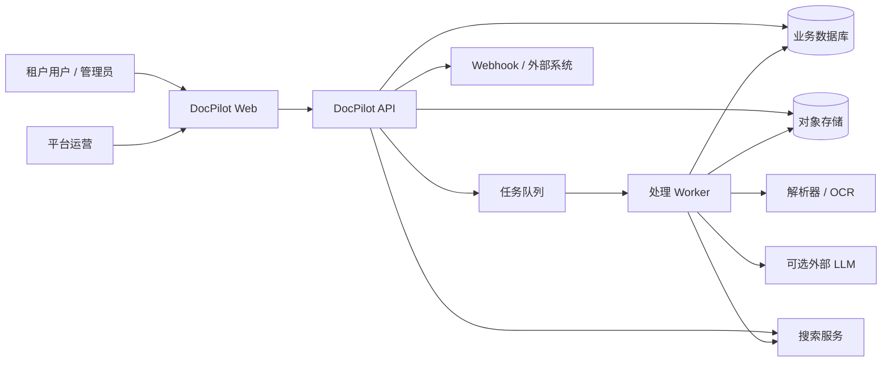

# 概要设计说明（系统架构）

| 属性 | 内容 |
|---|---|
| 文档编号 | DOC-ARCH-001 |
| 版本 / 状态 | 1.0 / 阶段 B–F 与阶段 G0–G28 已交付，维护轮 M1–M7 已交付（2026-10-10）；运行就绪收尾事项仍待处理 |
| 日期 | 2026-10-03（维护轮 M8 于 2026-10-10 更新模块视图与差距段） |
| 编写依据 | 参考 ISO/IEC/IEEE 42010:2022 架构描述观点 |

## 1. 架构目标与约束

目标是从当前单进程演示应用演进到可运营的多租户 SaaS。首要架构关切是租户隔离、文档隐私、任务可靠性、可扩展处理器、检索可追溯、可维护迁移和可观测性。

现有技术：FastAPI/Python、Vue 3/TypeScript/Vite、SQLAlchemy/Alembic、PyMuPDF、RapidOCR、openpyxl。默认运行基线仍为本地 SQLite、本机文件目录和进程内 JobManager；目标形态已作为可配置路径交付：设置 `BROKER_URL` 后由独立派发器与 Worker 承载执行，设置 `STORAGE_BACKEND=s3` 后文件读写只经 `ObjectStorage` 契约。PostgreSQL 基线已在阶段 G1（2026-10-03）落地并验证：本机 Docker Compose 依赖栈、迁移门禁脚本与备份恢复演练均已可重复运行；队列与租约见阶段 G2，对象存储见阶段 G3。阶段 G1–G6 已完成本地 PostgreSQL、队列/Worker、对象存储、读路径收口、管理界面与合成数据观测验证；阶段 G7 补做对象卷的备份恢复演练（`scripts/object_store_backup_drill.py`，卷级冷副本恢复到独立实例后核对键集合、尺寸与 SHA-256，并以三类破坏注入证明校验器有效），R-018 的"没有已验证备份"部分已消解，生产备份设施、周期与 RPO/RTO 仍待决策。端到端的运行形态已在阶段 G8（Compose 依赖栈 + 主机应用进程）与 G13（应用侧也进容器，`profile: app`）两种方式下各跑通同一套 12 条用例。剩余运行就绪事项和未决决策见 `docs/08`、`docs/17`。

当前系统已实现账号、租户、成员角色、邀请与审计，文档/模板/任务、复核、文档库、租户搜索、事件规则和运营探针。数据访问由服务端成员关系与角色授权约束。当前开发环境默认仍为 SQLite；PostgreSQL 已由阶段 G1 验证：`scripts/migration_gate.py` 完成空库 `upgrade head` → `downgrade -1` → `upgrade head` 且 `alembic check` 无漂移，用例在 PostgreSQL 与 SQLite 两种方言下各全量通过（设置 `TEST_DATABASE_URL` 即切换；G1 时 259 项，阶段 G6 交付后 303 项）。阶段 G2–G5 已交付独立 Worker 与队列、对象存储 adapter、剩余读路径切换与端到端用例（见 `docs/17`、`docs/09 §10`–`§14`）；阶段 G6 交付了可重复的合成数据观测（`scripts/capacity_observation.py` → `docs/18`），给出的是同机基线而非容量结论：真实提取器耗时、真实 1TB 语料与多机并发吞吐仍未验证。

受保护任务路由为 `/api/v1/tenants/{tenant_id}/jobs`。`tenant_id` 来自路径，但每次请求都通过会话、成员状态与角色授权校验。非开发环境禁止 SQLite，并要求发布前显式运行迁移。未配置 `BROKER_URL` 时任务由 API 进程内执行；配置后由独立派发器和 Worker 执行，多进程运行时须确保 Worker 已启动并接入队列。

## 2. 系统上下文

外部 OCR/LLM、邮件/网盘、客户系统均为数据处理边界；启用前需确定合同、数据位置、保留策略及失败行为。

## 3. 容器与模块视图

| 模块 | 职责 | 当前代码映射 / 目标 |
|---|---|---|
| Web UI | 登录、租户切换、上传、复核、文档库与搜索、模板、成员/邀请、事件规则 | `frontend/src` 七个工作区标签全部就位（处理/复核/文档库/模板/团队/自动化/配额，另有平台管理员可见的运营）；核心流程由 14 条 Playwright 端到端用例覆盖（`docs/06 §5.15`、`§5.29`），但只在系统 Chrome、只用 admin 角色跑过 |
| API/BFF | 认证、租户上下文、授权、校验、版本化接口 | `app/api` 与 `app/contexts/*/api.py` 提供身份、任务和上下文路由；`app/platform/request_context.py` 为每个请求建立关联 ID 并回填响应头（维护轮 M3，NFR-005） |
| 授权策略 | 角色矩阵判定、成员关系读取、默认拒绝 | `app/platform/http/dependencies.py` 提供服务端角色与平台身份依赖 |
| 成员与邀请服务 | 成员列表/角色变更/移除、邀请创建/撤销/接受 | `app/contexts/identity/service.py` + `frontend/src/components/TeamPanel.vue`；邮件投递仍未实现（令牌只在界面显示一次，需人工转交） |
| 审计事件 | 只追加记录授权变更与敏感数据操作 | `app/shared/audit.py` 与审计模型；`request_id` 列随维护轮 M3 加入（可空、无默认值）；保留/彻底删除策略待定 |
| 文档服务 | 文档元数据、版本、标签、生命周期 | `app/contexts/documents/`、`app/models/document.py`；文件仍在本地目录（`STORAGE_BACKEND` 默认 `local`，S3 实现已交付），实际清除流程待做 |
| 模板服务 | 文档类型、字段定义、模板版本 | `app/contexts/templates/` 已有不可变发布版本，管理界面在 `frontend/src/components/TemplatesPanel.vue` |
| 处理编排 | 创建任务、排队、重试、幂等、状态 | `app/contexts/processing/` 与 `app/contexts/processing/manager.py`；数据库任务快照、尝试记录和恢复已实现；`BROKER_URL` 为空时执行仍在 API 进程，配置队列后由派发器与独立 Worker 承接（阶段 G2 起） |
| 解析与提取 | PDF/图片解析、OCR、字段提取 | `app/adapters/parsing` 与 `app/adapters/extraction` 的接口已交付并有契约测试（维护轮 M2，`tests/test_adapter_contracts.py`，NFR-004） |
| 复核服务 | 原文预览、人工修订、确认/退回、修订链 | 阶段 D 已实现 `app/contexts/review/{domain,repository,service,api}.py`：文本与规范化结果与快照同事务落库，只追加修订链，乐观并发在数据库层判定 |
| 文档库 | 文件/任务/模板/审阅状态的浏览与筛选 | 阶段 D 已实现 `app/contexts/documents/{service,api}.py`：标签/类型/来源/保留状态/时间/文件名筛选与稳定分页，治理字段按角色拆分 |
| 检索服务 | 元数据、文件名、原文与字段值搜索 | 阶段 E 已实现 `app/contexts/search/{domain,service,api}.py`：索引行与结果/修订同事务重建，查询词按不可信输入转义并限长，命中只在本租户范围内。**没有搜索后端抽象**：换后端要改仓储函数（`docs/07 NFR-004` 记为此项未做） |
| 导出/集成 | XLSX/CSV、API、Webhook/连接器 | XLSX 与 CSV 已实现且共用单元格归一；出站 Webhook 机制已于阶段 G14 交付但**默认关闭**（无 `WEBHOOK_MASTER_KEY` 即拒绝建端点与启动投递，`docs/21`）；版本化 API 一侧由 G9 退役无租户 `/api/jobs` 后确立；API 密钥体系与部署侧密钥流程仍未实现，待业主确认 |
| 工作流与自动化 | 事件规则、动作执行、运行日志、通知登记 | 阶段 E 已实现 `app/contexts/automation/{domain,service,api}.py`：白名单事件与动作、规则版本、`delivery_key` 幂等重试；通知只登记不投递 |
| 平台管理 | 租户状态、资源用量、失败摘要、健康/就绪探针 | 阶段 F 已实现 `app/contexts/operations/{service,api}.py`：实时从业务表聚合、无物化表、平台视图不含客户内容；**配额强制已交付**（阶段 G18，两轴、无行即不限、判定先于任何写入）并有管理界面（G22）；**计费仍未实现**（缺单价口径） |

## 4. 核心数据流

1. Web 以用户会话发起请求；API 解析用户、成员关系和租户角色，按 DOC-DD-003 默认拒绝矩阵授权。
2. 管理员创建一次性邀请；令牌只存摘要。已登录且邮箱匹配的用户接受后，成员关系和审计事件同事务提交。
3. 上传 API 校验身份、租户权限和文件策略；当前文件写入本机目录，数据库保存 Document/DocumentVersion、任务和审计信息。
4. 处理调度支持两种运行形态（阶段 G2）：未设置 `BROKER_URL` 时仍由 API 进程内执行；设置后任务与派发记录同事务落库，由 `app.dispatcher` 投递队列（拿到发布确认才推进），`app.worker` 独立进程消费。
5. Worker 从队列领取任务后先以条件更新获取执行租约并周期续租，结果与租约在同一事务收口，因此重复投递只有一个执行者、被接管的旧执行者无法覆盖新尝试（`docs/adr/0004`）。文件仍从本机目录读取，对象存储 adapter 属阶段 G3。
6. 复核人员读取授权文档与结果；人工修订为只追加记录并受乐观并发控制。
7. 已确认结果更新租户检索索引，可导出并记录审计；事件规则当前通过手动 dispatch 消费。

## 5. 关键架构决策原则

- 模块边界、聚合归属与统一语言由 `docs/12-领域驱动设计与限界上下文.md`（DOC-DDD-001）定义；本文件的模块视图与代码布局以该上下文划分为准（决策依据见 ADR-0003）。
- 初期采用模块化单体加独立异步 Worker；避免在团队和负载未知时过早拆微服务。
- 数据库记录租户归属并可增加 PostgreSQL Row-Level Security 作为纵深防御；所有业务查询仍需显式授权。
- 原始文件放对象存储，数据库只存元数据、状态和结果；对象键使用随机 ID，不使用用户文件名。
- 队列为至少一次投递假设，Worker 必须幂等；业务事件通过 outbox 或等价机制避免数据库与消息双写不一致。
- 搜索先从 PostgreSQL 元数据和全文能力开始，规模或质量不足后替换/增加专用搜索引擎。
- LLM/OCR 通过 adapter 封装，按租户配置、超时、重试、预算和外部数据策略控制。

## 6. 部署视图（目标形态）

反向代理/TLS → Web 静态资源/API → 关系数据库、对象存储、队列 → 一个或多个 Worker → OCR/LLM 外部服务。日志、指标、追踪、密钥管理和备份为独立运维能力。最终云厂商、地域、网络拓扑、可用性及备份目标待评审。

## 7. 信任边界和威胁关注

边界包括浏览器到 API、租户到租户、API 到 Worker、应用到对象存储/数据库、平台运营到客户数据、系统到外部模型/集成。重点威胁：IDOR/租户越权、恶意/压缩炸弹文件、公式注入、提示注入、凭据泄露、回调伪造、重放、队列污染、缓存/索引串租户和错误日志泄露。

## 8. 当前到目标的主要差距

当前到目标的主要差距：`processing_jobs.snapshot` 已不再是任何读路径的来源（G21 切读完成），但列本身仍在写入，删列（R6）仍待 `docs/20 §6` 的门禁；退役方案的 R1（规范化列）与 R2（与快照同事务双写）已于阶段 G19 合入，R3（幂等回填）与 R4（逐键对账，非零退出即阻塞删列）已于阶段 G20 合入并在真实开发数据上出过报告，R5 切读已于阶段 G21 合入（不可重建的任务报 503 而不是被拼成一个假对象），只剩 R6 删列（`docs/20`）；出站 Webhook 的机制已在阶段 G14 交付但默认关闭（无主密钥即拒绝建端点与启动投递），部署侧密钥流程与内网目标放行仍待业主确认（`docs/21`、`docs/16 §1`）；`/readyz` 已判定对象存储可达性（阶段 G15，TC-OPS-002：`local` 不参与判定、声明 `s3` 时问不到桶即 503），仍不判定提取依赖（真实 OCR/LLM 未接入）。端到端环境已收口：一次性本地进程（默认基线）、Compose 依赖栈 + 主机应用进程（G8）、Compose 依赖栈 + 应用侧容器（G13）三种形态都跑过同一套 12 条用例。已于 2026-10-03 完成的部分：阶段 G1 让 PostgreSQL 成为可重复验证的集成数据库（迁移门禁 + 用例在 PG 与 SQLite 双方言通过）、本机 Compose 依赖栈与数据库备份恢复演练；阶段 G2 交付 RabbitMQ + 自建派发器/独立 Worker + 执行租约与超时回收（`docs/adr/0004`）；阶段 G3 交付 `ObjectStorage` 契约的 Local/S3 双实现、按任务前缀的失败补偿、只报告的孤儿审计与带校验和的幂等回填。阶段 G4 把 `/result`、`/excel` 与 `/export` 统一到以 `extraction_results` 为权威源并收口三方言残留；阶段 G5 交付模板/成员邀请/事件规则三块管理界面、`GET /automation/meta` 单点白名单、`/readyz` 的队列消费者判定，以及 10 条 Playwright 端到端用例；阶段 G6 交付合成数据容量观测脚本与报告（`docs/18`），覆盖读路径时延与租户隔离、并发调度吞吐与队列延迟、大对象/分页/导出的内存与磁盘形状。默认运行基线未变：`BROKER_URL` 为空即进程内执行、`STORAGE_BACKEND` 默认 `local`，切到队列或对象存储都要按 `docs/17` 的顺序配置。阶段 G 仅规划本地 Docker Compose 开发验证，不代表线上部署已就绪。

**维护轮 M1–M7（2026-10-10）补上或更正的差距**（逐条带证据，见 `docs/09 §39`–`§45`）：

- **已关闭**：`NFR-004` 的适配器契约测试（M2，`tests/test_adapter_contracts.py` 8 条）；`NFR-005` 的 `request_id` 贯穿（M3 后端 + M4 前端，26 条 + 一条浏览器断言）；`quota.spec.ts` 的顺序依赖（M5）；结果幕缺"再处理一份"入口（M6，TC-E2E-004）。
- **已取证、结论未变**：R6 删列门禁（M7）。判据已实跑（两个库对账均 `CLEAN`、`job.rebuild_incomplete` 均为 0），但门禁第 2 条的"每一个受影响库"在本机无法闭合（只有两个库）、第 1 条的观察期认定需业主确认、第 3 条的纯逻辑导出兜底未执行、第 4 条未批。**R6 仍不得执行**，表见 `docs/20 §6.2`。
- **仍未做**：搜索后端抽象（`NFR-004` 声明了可替换，但检索直接查表，无接口可注入）；单例流水线的解析器/提取器注入点（M2 实测：换工厂函数对它们不生效）；`request_id` 未进任务与结果表、未做跨服务传播；Webhook 管理界面；计费与通知渠道（缺业主输入）。
