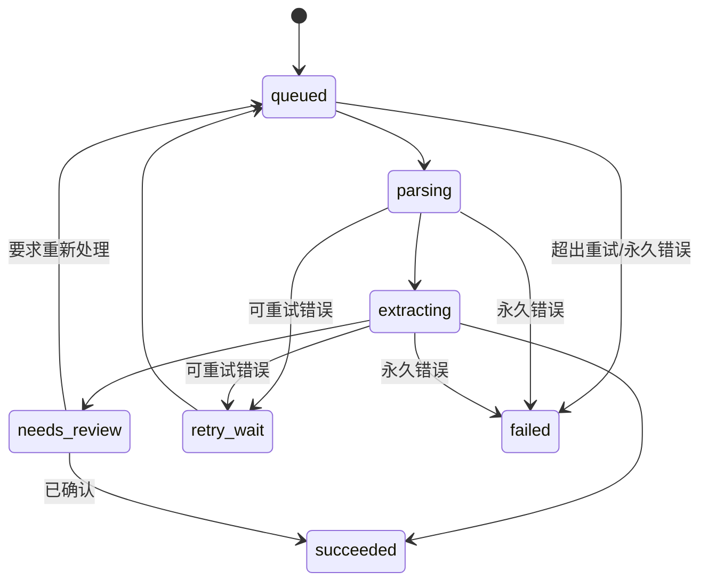

# 详细设计说明（多租户文档处理首期）

| 属性 | 内容 |
|---|---|
| 文档编号 | DOC-DD-001 |
| 版本 / 状态 | 0.1 / 草案；需 G1 架构评审后批准 |
| 日期 | 2026-10-02 |
| 目标 | 定义可分迭代实现的首期逻辑设计，不锁定尚未批准的具体供应商 |

## 1. 首期切片

首期目标为“登录与租户上下文 → 配置模板 → Web 上传 → 异步处理 → 人工复核 → 历史查看与导出”。基础搜索限定为文件名、状态、日期、提取字段及 OCR 文本的简单查询。工作流、开放 API、计量计费与复杂全文检索不纳入首期承诺。

## 2. 逻辑组件与边界

| 组件 | 输入/输出 | 关键约束 |
|---|---|---|
| Auth/RBAC | 会话/token → User + membership + permissions | tenant_id 来自经验证的 membership，不信任请求体 |
| Tenant Context | 请求/任务上下文 → TenantScope | 所有服务层读写操作都要求 TenantScope |
| Document API | 文件流 → Document/Version + object key | 不使用用户文件名作为路径；验证内容并限制资源 |
| Template Service | 字段定义 → TemplateVersion | 发布版本不可变；引用字段 ID，名称可变更需兼容 |
| Job Orchestrator | document/version + template version → Job | 幂等键、状态机、重试计数、租户配额 |
| Worker | job → ParseArtifact + ExtractionResult | 限时/限内存处理；按至少一次投递编写幂等逻辑 |
| Review Service | result revision + edits → confirmed result | 乐观并发版本号；审阅改动全量审计 |
| Search/Export | tenant-scoped query → page/export | 授权重验；导出有时效和审计 |

## 3. 领域实体（建议）

| 实体 | 关键字段 | 关系/约束 |
|---|---|---|
| Tenant | id, name, status, plan_id, created_at | 所有客户业务数据的根归属 |
| User | id, email, status, created_at | 身份主体，可关联多个租户 |
| Membership | tenant_id, user_id, role, status | `(tenant_id,user_id)` 唯一；授权依据 |
| Document | id, tenant_id, type_id, status, uploader_id, created_at | tenant_id 必填；软删除/保留策略待定义 |
| DocumentVersion | id, document_id, object_key, checksum, mime, size, page_count | 原始文件版本不可覆盖 |
| DocumentType | id, tenant_id, name, status | 租户自定义类型 |
| TemplateVersion | id, type_id, version, schema_json, published_at | 已发布版本不可变 |
| ProcessingJob | id, tenant_id, document_version_id, template_version_id, status, retry_count, idempotency_key | 任务与源版本/模板版本固定关联 |
| ParseArtifact | id, job_id, text_ref, parser_name, parser_version, warnings | OCR 文本需按敏感数据策略保护 |
| ExtractionResult | id, job_id, revision, values_json, confidence_json, status | 每次人工修改生成新 revision |
| ReviewEvent | id, tenant_id, result_id, actor_id, before_json, after_json, reason, at | append-only 审计记录 |
| AuditEvent | id, tenant_id nullable, actor_id, action, resource, request_id, at | 平台动作 tenant_id 可空且需平台权限 |

主键建议用不可预测 ID；所有 tenant-owned 表含 tenant_id，并以复合唯一/外键约束防止跨租户关联。文件存储 key 与数据库记录绑定，但不把绝对文件路径暴露给 API。

## 4. 任务状态机

批次任务与单文件子任务分开建模；批次状态根据子任务汇总为 queued/running/succeeded/partial/failed。错误需区分可重试/不可重试，且不可向客户端返回堆栈或路径。

## 5. API 草案

API 前缀 `/api/v1`。身份认证方式和 session/cookie/CSRF 策略需 G1 定案。

| 方法与路径 | 用途 | 权限/注意事项 |
|---|---|---|
| `GET /me/tenants` | 列出当前用户租户 | 只返回 membership 可访问项 |
| `GET/POST /tenants/{tenant_id}/templates` | 查看/创建模板 | 服务端验证管理员权限及租户归属 |
| `POST /tenants/{tenant_id}/documents` | 上传文档 | 大小/MIME/签名/配额/病毒扫描策略 |
| `POST /tenants/{tenant_id}/jobs` | 提交处理任务 | 固定 template_version_id；支持 Idempotency-Key |
| `GET /tenants/{tenant_id}/jobs/{job_id}` | 查看状态 | 每次查询校验 job.tenant_id |
| `GET /tenants/{tenant_id}/documents/{id}` | 查看元数据/预览链接 | 短时签名下载或鉴权代理 |
| `GET /tenants/{tenant_id}/documents` | 文档库分页/搜索 | 服务端过滤、游标分页、查询限流 |
| `PATCH /tenants/{tenant_id}/results/{id}` | 保存复核修改 | If-Match/version 防并发覆盖 |
| `POST /tenants/{tenant_id}/results/{id}/confirm` | 确认提取结果 | 角色检查、审计、触发明确事件 |
| `POST /tenants/{tenant_id}/exports` | 创建导出 | 后台生成；导出下载需重新鉴权 |

错误响应使用稳定错误码、用户可理解描述和 request_id。接口不返回内部路径、凭据、提示词秘密或完整堆栈。API 错误 schema、分页、时限和限流数字待定。

## 6. 文件处理安全设计

- 上传写入临时隔离区，检查扩展名、声明 MIME、文件签名、解码器可读性和资源上限；策略通过后转存对象存储。
- 文件名仅作为展示元数据保存并做长度/控制字符约束；对象 key 使用随机 ID。
- PDF 页数、页面尺寸、图像像素、解压比、解析时间和 OCR 并发有硬限制；超过限制形成用户可见错误。
- 对象存储默认私有；下载授权后生成短时 URL 或由 API 流式代理。
- 对病毒扫描、静态隔离、加密、删除传播和备份留存的实施策略需按部署环境评审。

## 7. 队列、幂等与一致性

队列消息至少包含 `job_id`、`tenant_id`、`schema_version`，不直接承载文档全文。消息租户 ID 必须与数据库任务归属一致。Worker 在处理前重新加载任务并检查状态；结果写入采用唯一任务/阶段约束或版本控制。推荐 transactional outbox 保证数据库任务与消息投递一致；具体队列/事务实现另立 ADR。

## 8. 事务与并发

模板发布使用版本新增而不是原地修改。审阅更新带期望 revision，冲突返回 409 并要求重新载入。删除文档先改变生命周期状态并发起异步删除，清理对象、索引、派生文本和导出后记完成状态；备份中的删除传播时限需定义。

## 9. 部署、配置与迁移

数据库迁移必须向前兼容：先增加字段/表，再双写或回填，最后移除旧结构。生产密钥从 secret manager 注入；环境配置和数据库连接字符串不能输出到日志。健康检查区分 liveness/readiness；Worker 可独立横向扩展。

## 10. 待架构评审项

认证服务和登录方式、关系数据库/对象存储/队列选型、行级安全是否启用、租户自助注册、病毒扫描、外部 LLM 隐私合同、加密密钥管理、审计留存、删除周期、RPO/RTO、API 配额和首期规模目标。
