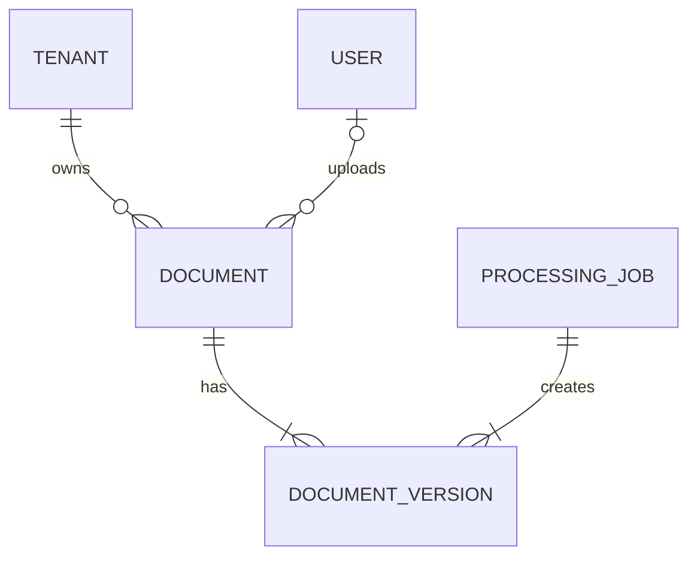

# 文档实体与兼容迁移设计

| 属性 | 内容 |
|---|---|
| 文档编号 | DOC-DD-002 |
| 版本 / 状态 | 0.1 / 设计草案，待评审 |
| 日期 | 2026-10-02 |
| 关联需求 | FR-010、FR-011、FR-020、FR-021、NFR-001、NFR-003 |
| 依据 | `docs/05-首期详细设计说明.md`、ADR-0001、ADR-0002 |

## 1. 目标与范围

在现有多租户任务处理链路中加入可追溯的文档资产记录，为后续文档库、重新处理、保留与删除能力建立数据基础。本阶段采用兼容迁移：新任务同时写入规范化文档元数据和现有任务 JSON 快照，已有 API 响应和结果读取方式保持不变。

本阶段覆盖 `Document`、`DocumentVersion`、现有 `ProcessingJob` 的关系、数据库迁移、新上传写入和失败清理。不实现模板管理、不可变模板版本、结果表拆分、文档库 API、对象存储迁移或历史快照回填。字段定义仍随现有任务请求提交，并保存在任务快照中。

## 2. 方案与取舍

采用共享数据库中的租户逻辑隔离。一次任务上传中的每个文件创建一份 `Document` 和一条 `DocumentVersion`；每个文件版本直接记录产生它的 `ProcessingJob`。

当前产品流程中没有独立文档库，也没有选择既有文档并重复处理的入口。直接通过版本上的 `job_id` 关联任务，能够以较少改动建立来源追溯。未来需要对同一文件版本执行多个任务时，再引入任务与文件版本的关联实体；不在本阶段预留尚无消费者的关联表。

模板版本暂缓建模。当前字段定义随请求提交，接口没有稳定的 `template_id`，将其存成可复用模板会混淆一次性处理参数与客户配置资产。

## 3. 领域模型

### 3.1 Document

表示租户拥有的一份逻辑文档。一次上传中的每个文件创建一份文档。

| 字段 | 约束/用途 |
|---|---|
| `id` | 不可预测的 32 位十六进制 ID，主键 |
| `tenant_id` | 必填，所属租户 |
| `owner_id` | 可空；用户删除后置空 |
| `status` | 生命周期状态，初始为 `active` |
| `created_at` | UTC 创建时间 |

### 3.2 DocumentVersion

表示文档的不可变文件内容版本。数据库记录元数据和相对存储键，不保存绝对路径。

| 字段 | 约束/用途 |
|---|---|
| `id` | 不可预测 ID，主键 |
| `document_id` | 必填，所属文档 |
| `tenant_id` | 必填，冗余租户键，用于租户过滤和一致性约束 |
| `job_id` | 新建版本时必填，指向产生它的任务；任务记录删除后可置空以保留文档版本 |
| `revision` | 文档内递增版本号；初次上传为 1，`(document_id, revision)` 唯一 |
| `original_filename` | 展示用原始文件名，不用于构造存储路径 |
| `storage_key` | 相对上传根目录的随机对象键，唯一 |
| `checksum` | 文件内容 SHA-256 |
| `media_type` | 服务端判定或确认的媒体类型 |
| `size_bytes` | 文件字节数 |
| `created_at` | UTC 创建时间 |

上传 API 当前限制每个文件最多 20 MB、每个任务最多 10 个文件；表字段需能表示配置允许的文件大小。版本创建后不原地改写文件内容或元数据。更正内容时创建新版本。

### 3.3 关系

任务 JSON 快照暂时保留原字段和文件列表，作为现有 API/处理管线的兼容读模型。规范化表是新上传文件元数据的持久化来源；快照与规范化记录在写入时保持一致。

所有文档和版本查询必须携带租户上下文。优先使用复合唯一键及复合外键保证 `DocumentVersion.tenant_id`、其所属 `Document.tenant_id` 和 `ProcessingJob.tenant_id` 一致；写入服务仍需校验租户上下文，不能依靠客户端传入的租户 ID。任务删除后 `job_id` 置空时，文档版本的租户一致性约束仍由版本到文档的复合外键保证。

## 4. 上传写入流程

1. 完成身份、CSRF、租户成员、文件数量/大小/扩展名和字段定义校验。
2. 生成任务 ID、每个文件的随机存储键和文档/版本 ID；写入私有租户目录，展示文件名不参与路径生成。
3. 创建任务快照及规范化记录：每个文件一条 `Document` 和 `DocumentVersion`，版本关联任务并保存校验和、媒体类型、大小和相对存储键。
4. 数据库事务提交成功后，调度现有后台处理任务。任务处理管线仍从兼容快照读取路径和字段。
5. 查询任务和导出响应保持现有形状；本阶段不新增面向客户端的绝对路径或文档元数据接口。

写入失败时回滚事务并删除本次创建的文件和目录。清理操作必须限定在当前任务生成的路径下，不得删除其他任务或租户文件。后台任务不能在关联元数据提交前启动。

## 5. 数据库迁移与兼容

- 新增 `documents` 和 `document_versions` 表及索引、唯一约束和外键；为现有任务表增加 `(tenant_id, id)` 唯一键，供复合外键引用。
- 现有 `processing_jobs` 与快照结构不变；无需停机回填旧任务。
- 历史任务继续由 `JobRepository` 从 JSON 快照还原。历史快照没有可靠、统一的校验和/媒体类型和版本来源信息，本迁移不猜测或伪造这些元数据。
- 新任务采用双写。若数据库写入失败，不能留下可见的半成品任务；若文件已落盘，执行有界回滚清理。
- SQLite 与 PostgreSQL 均需支持迁移升级和降级。外键的多列租户一致性约束须确认 Alembic/SQLite 支持方式；若 SQLite 无法安全创建约束，应用写入前置校验必须有负向集成测试，并记录 PostgreSQL 上的约束行为。
- 本阶段不删除旧 JSON 字段，也不改变现有 API 响应。后续完成读路径切换并验证历史数据后，另行设计快照字段退役迁移。

## 6. 失败处理与生命周期

- 文件写入失败：返回稳定错误，不创建成功任务或文档记录；清理本次已写文件。
- 元数据事务失败：回滚任务/文档/版本记录，删除本次文件；不能启动后台处理。
- 后台处理失败：保留文档及版本元数据，任务按现有失败状态记录；失败文件仍能追溯来源。
- 数据库中的 `storage_key` 始终相对配置的上传根目录解析；读路径必须验证解析后路径仍在根目录下。
- 本阶段不提供文档删除 API。外键删除策略需保护任务追踪和审计需要；实现时不得因任务清理意外删除原始文件或文档元数据。

## 7. 验收与测试设计

| 用例 | 验收条件 |
|---|---|
| 单文件上传 | 创建一个任务、一份文档和一个文件版本；租户、上传者、文件名、大小、校验和、存储键均正确 |
| 多文件上传 | 每个上传文件对应独立文档和版本，版本均指向同一任务，顺序与任务快照一致 |
| 跨租户一致性 | 不能把租户 A 的文档/版本关联到租户 B 的任务；服务端拒绝且无部分写入 |
| 旧任务兼容 | 仅有旧 JSON 快照的任务仍可读取、查询结果和导出 |
| 文件写入失败 | 任务、文档和版本均无残留，部分落盘文件被清理 |
| 数据库提交失败 | 事务回滚，已落盘文件被清理，后台处理未启动 |
| 路径安全 | 存储键解析后位于配置上传根目录；用户文件名不参与存储路径 |
| 迁移往返 | 空 SQLite 库可升级；升级后可降级；PostgreSQL 迁移在实际或 CI 服务上单独验证 |

## 8. 实施边界与后续决策

本设计通过评审后，实施计划应先完成模型/迁移，再接入上传事务和清理，再补测试及追踪文档。每一步保持任务快照兼容。

下阶段需另行决定：文档去重与逻辑身份规则、同一版本重复处理的关联模型、可复用模板及不可变模板版本、对象存储抽象、保留与删除传播策略，以及历史快照回填是否有业务价值。
