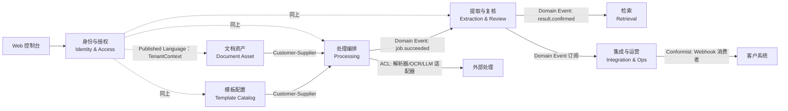

# 领域驱动设计：战略设计与限界上下文

| 属性 | 内容 |
|---|---|
| 文档编号 | DOC-DDD-001 |
| 版本 / 状态 | 0.1 / 设计基线，待评审 |
| 日期 | 2026-10-02 |
| 关联需求 | 全部 FR/NFR；架构依据 `docs/04-概要设计说明.md`；决策见 ADR-0003 |
| 作用 | 约束阶段 C–F 的模块划分、代码归属、聚合不变式与跨上下文协作方式 |

## 1. 为什么需要这份文档

`docs/04` 给出的是进程与部署视角的模块视图，回答"系统由哪些块组成、跑在哪里"。它不回答三个会在阶段 C–F 反复引发返工的问题：某个规则该写在哪儿、一个业务对象的唯一权威来源是谁、两处代码需要同一个数据时谁是提供方。本节用 DDD 战略设计回答：先划子域与限界上下文，再定聚合与不变式，最后约定代码归属与协作契约。

## 2. 子域与优先级

| 子域 | 类型 | 承担的职责 | 需求 | 优先级 |
|---|---|---|---|---|
| 提取与复核 | 核心域 | 文档→结构化字段→人工确认的可追溯闭环，含置信度与修订历史 | FR-021/022/023 | 最高 |
| 模板配置 | 支撑域 | 文档类型与字段定义的生命周期、不可变版本 | FR-012 | 高 |
| 处理编排 | 支撑域 | 任务、尝试、幂等、超时回收、部分成功 | FR-020/024/025 | 高 |
| 身份与授权 | 支撑域 | 用户、成员关系、角色矩阵、邀请、会话 | FR-001..006 | 高（已完成阶段 B） |
| 文档资产 | 支撑域 | 文档与文件版本、存储键与校验和、生命周期 | FR-010/011/013 | 中 |
| 检索 | 支撑域 | 元数据与字段检索、索引与源数据一致性 | FR-030/031 | 中 |
| 集成与运营 | 通用域 | Webhook/API、计量、审计、通知 | FR-032/040/041/042、FR-006 | 后续 |

判定依据：凡是客户愿意为"更准、更可追溯"持续付费的能力是核心域（提取与复核）；其余按支撑/通用分类，通用域优先复用而非自研。

## 3. 统一语言

术语在代码、文档、API 与界面中必须一致；"禁用同义词"列是评审检查项。

| 术语 | 定义 | 代码对象 | 禁用同义词 |
|---|---|---|---|
| 工作空间 / 租户 | 一个客户的数据与授权边界 | `Tenant` | 账户、组织、公司 |
| 成员 | 用户与工作空间的关系，携带角色与状态 | `Membership` | 用户-租户映射 |
| 角色 | `owner`/`admin`/`member`/`reviewer`，工作空间内生效 | `Membership.role` | 权限、权限组 |
| 平台管理员 | 跨工作空间的运营身份，**不产生**工作空间数据访问权 | `User.is_platform_admin` | 超级租户管理员 |
| 邀请 | 一次性、短期有效、绑定邮箱与角色的加入凭证 | `Invitation` | 注册链接 |
| 文档 | 客户拥有的一份逻辑文档资产 | `Document` | 文件（文件指字节对象） |
| 文件版本 | 文档某一次不可变的内容版本 | `DocumentVersion` | 附件、上传记录 |
| 存储键 | 相对存储根的对象键，随机生成，不含用户文件名 | `DocumentVersion.storage_key` | 路径、URL |
| 模板 | 某类文档的可复用字段配置 | `Template`（阶段 C） | 表单、schema |
| 模板版本 | 模板一次发布的不可变快照（字段集） | `TemplateVersion`（阶段 C） | 草稿版本 |
| 字段定义 | 单个待提取字段的名称/类型/描述 | `FieldDefinition` | 列、参数 |
| 处理任务 | 对一组文件版本的一次处理请求 | `PersistentJob` | 作业、批任务 |
| 任务尝试 | 任务的一次执行记录，含失败原因与耗时 | `JobAttempt`（阶段 C） | 日志条目 |
| 幂等键 | 调用方提供的重复提交判定依据 | `ProcessingJob.idempotency_key`（阶段 C） | 请求 ID |
| 提取结果 | 一个文件版本在某模板版本下的字段值集合 | 阶段 C/D 的 `ExtractionResult` | 输出、OCR 结果 |
| 结果版本 | 提取结果的一次不可变修订，带乐观并发号 | 阶段 D 的 `ResultRevision` | 编辑记录 |
| 复核 | 对结果版本的确认/退回动作及其理由 | 阶段 D 的 `ReviewEvent` | 审核 |
| 审计事件 | 已发生事实的只追加记录，无修改删除入口 | `AuditEvent` | 操作日志（日志是文本，审计是业务记录） |
| 领域事件 | 上下文之间传递的业务事实（`document.uploaded` 等） | 阶段 C 的 outbox | 消息 |

## 4. 限界上下文与上下文映射



| 关系 | 类型 | 约束含义 |
|---|---|---|
| 身份与授权 → 其他全部 | 发布语言（Published Language） | 其他上下文只接受服务端解析出的 `TenantContext`（含租户与角色），永不接受请求体里的租户/角色 |
| 文档资产 → 处理编排 | 客户-供应商 | 处理只消费 `DocumentVersion` 的存储键与校验和，不得自行拼接磁盘路径 |
| 模板配置 → 处理编排 | 客户-供应商 | 任务必须引用**已发布**的模板版本；模板发布不影响在跑任务 |
| 处理编排 → 提取与复核 | 领域事件 | `job.succeeded` 后结果方可进入复核；处理上下文不知道复核规则 |
| 解析/OCR/LLM | 防腐层（ACL） | 现有 `app/services/parsing`、`app/services/extraction` 是唯一入口，供应商差异不得泄漏到聚合 |
| 集成与运营 → 客户系统 | 顺从（Conformist） | Webhook 载荷由我方定义，重试/签名规则写在阶段 F 设计 |

## 5. 聚合、不变式与权威来源

聚合是修改边界；一个事务只改一个聚合。跨聚合只持有 ID。

| 聚合根 | 包含 | 不变式（违反即拒绝） | 状态 |
|---|---|---|---|
| `Membership` | 用户与工作空间的关系 | 每个工作空间至少一名 active `owner`；同一 `(tenant,user)` 唯一；owner 只能由创建/转让产生 | 阶段 B 已实现 |
| `Invitation` | 一次性邀请 | 令牌仅存摘要；同邮箱同时至多一条 pending；接受/撤销只能通过条件更新一次性生效 | 阶段 B 已实现 |
| `Document` + `DocumentVersion` | 文档与其不可变内容版本 | 版本内容写定后不改；`(document,revision)` 唯一；`storage_key` 全局唯一且解析后必须落在存储根内 | 阶段 B 前已实现（`docs/10`） |
| `Template` + `TemplateVersion` | 模板与其发布快照 | 已发布版本不可修改；字段集在版本内冻结；被任务引用的版本不得删除 | 阶段 C |
| `ProcessingJob` + `JobAttempt` | 任务与其执行尝试 | 任务引用具体 `template_version_id` 或显式内联字段，二者必居其一；同 `(tenant, idempotency_key)` 不重复创建；尝试数与并发有上限；超时尝试可被回收 | 阶段 C |
| `ExtractionResult` + `ResultRevision` | 文件版本在模板版本下的字段值与修订链 | 并发保存需匹配当前 revision 号；确认动作需 `reviewer` 以上角色；修订链可追溯到人 | 阶段 D |
| `SearchDocument`（索引条目） | 检索用的派生数据 | 与源数据同租户；源删除时索引必须删除 | 阶段 E |
| `AuditEvent` | 只追加事实记录 | 不提供更新/删除接口；`metadata` 只允许登记键 | 阶段 B 已实现 |

现状偏差与处理：`PersistentJob.snapshot` 是 JSON 大杂糅，把字段定义、文件信息与结果一起存，违反"任务引用模板版本"的不变式。阶段 C 的迁移策略与 `docs/10` 一致——**双写不回填**：新任务同时写规范化列（`template_version_id`、`idempotency_key`、`created_by`）与快照，快照继续作为兼容读模型；快照字段退役留到阶段 D 读路径切换后单独立项。

## 6. 领域事件与投递保证

命名规则：`<聚合根>.<过去式动词>`，载荷只含事实与 ID，不含指令。

| 事件 | 发布方 | 已知消费方 | 保证 |
|---|---|---|---|
| `document.uploaded` | 文档资产 | 处理编排（同进程调用） | 与记录同一事务写入 outbox |
| `job.queued` / `job.succeeded` / `job.failed` | 处理编排 | 检索、集成与运营 | 至少一次；消费方按 `job_id + event` 幂等 |
| `result.revised` / `result.confirmed` | 提取与复核 | 检索、通知 | 同上 |
| `member.invited` / `member.removed` 等 | 身份与授权 | 审计 | 阶段 B 直接写审计表，事件化在阶段 F 收口 |

投递采用事务性 outbox 表（阶段 C 建表，阶段 E/F 接入真实队列），避免"业务已提交、消息丢失"的双写不一致。当前后台任务仍是进程内执行，outbox 先记录不发；这一步不改变可横向扩展性结论（`docs/09` 已知缺口仍成立）。

## 7. 代码归属约定（渐进重构，不搞大爆炸）

新增上下文按以下骨架落位，存量代码在触及它的阶段内迁移，不单独开重构分支：

```
app/contexts/<context>/
  domain.py       # 聚合、值对象、不变式、状态机（纯 Python，不导入 FastAPI）
  repository.py   # SQLAlchemy 持久化；所有查询强制带 tenant_id
  service.py      # 用例编排：事务边界、领域事件、审计
  api.py          # 传输层：请求模型、角色依赖、状态码翻译
```

| 上下文 | 当前代码 | 目标归属 |
|---|---|---|
| 身份与授权 | `app/models/account.py`、`app/models/access.py`、`app/api/{auth,tenants,members}.py`、`app/services/{membership,audit}.py` | 阶段 D 收拢到 `app/contexts/identity/` |
| 文档资产 | `app/models/document.py`、`app/services/document_storage.py`、`app/services/job_repository.py` 中的版本写入 | 阶段 C 收拢 |
| 模板配置 | 无 | 阶段 C 新建 `app/contexts/templates/` |
| 处理编排 | `app/services/{job_manager,pipeline}.py`、`app/api/workspace_jobs.py` | 阶段 C 在 `app/contexts/processing/` 承载新增能力（尝试、幂等、超时回收、outbox），阶段 D 再把旧模块迁入同一上下文 |
| 解析与提取适配器 | `app/services/{parsing,extraction}/*` | 保持原位，作为 ACL 供处理编排调用 |
| 提取与复核 | 无 | 阶段 D 新建 `app/contexts/review/` |

硬性规则（评审检查项）：
1. `repository` 的每个查询方法必须显式接收 `tenant_id`，无租户参数的方法只能命名 `*_internal` 且仅供 worker 使用（阶段 B 的 P0 教训）。
2. `domain.py` 不得导入 `fastapi`、`sqlalchemy.orm` 之外的传输/持久化设施。
3. 跨上下文引用只允许传 ID，不允许传递对方 ORM 对象。
4. 授权判定只写在 `api.py` 的依赖声明处，服务层不复判角色（服务层负责业务保护）。

## 8. 阶段映射与出口条件

| 阶段 | 涉及上下文/聚合 | 出口条件 |
|---|---|---|
| C 文档处理闭环 | 模板配置（新）、处理编排（含 JobAttempt/幂等）、文档资产 | 模板发布后不可变且任务可追溯到版本；同幂等键不重复处理；超时尝试可回收；迁移往返通过 |
| D 复核与文档库 | 提取与复核（新）、文档库读路径 | 修订链与并发冲突可验证；确认结果不可被静默覆盖；阶段 B 遗留的身份上下文收拢不破坏 168 项测试 |
| E 搜索与自动化 | 检索（新）、事件消费 | 索引与源数据删除一致；跨租户检索负向用例通过 |
| F 运营与集成 | 集成与运营 | Webhook 签名/重试/幂等契约有自动化验证；用量计量不绕过授权 |

## 9. 取舍与已知代价

- 不引入独立微服务与共享数据库：模块化单体 + 明确聚合边界，符合 `docs/04 §5` 的判断，代价是边界靠约定与评审维持。
- 暂不引入通用 RBAC/权限表：矩阵固定四角色，表驱动会在无第二消费方时变成负担；矩阵外动作默认拒绝由 `require_roles` 保证。
- 快照双写期会长期存在：换取兼容读路径与零回填风险，代价是两套真相并存，因此第 5 节明确"快照是兼容读模型，规范化表是新写入的权威来源"。
- outbox 先建表不接队列：阶段 C 没有真实消息中间件，先把投递事实落库，避免阶段 E 再改写入路径。
