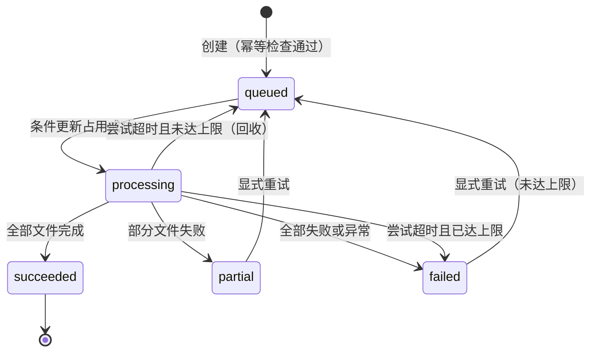

# 模板版本与处理闭环详细设计说明（阶段 C）

| 属性 | 内容 |
|---|---|
| 文档编号 | DOC-DD-004 |
| 版本 / 状态 | 0.1 / 设计草案，待评审 |
| 日期 | 2026-10-02 |
| 关联需求 | FR-012、FR-013、FR-020、FR-021、FR-022、FR-024、FR-025、NFR-001、NFR-003、NFR-008 |
| 依据 | `docs/12-领域驱动设计与限界上下文.md`（聚合与上下文归属）、`docs/10`、`docs/11`、ADR-0001..0003 |

## 1. 目标与范围

把"字段定义随请求提交的一次性处理"升级为"可复用模板 + 不可变模板版本 + 可追溯处理任务"，并补齐处理可靠性语义：任务尝试记录、幂等提交、超时回收、有界重试与部分成功状态。

本期不实现：对象存储迁移、独立消息队列与多进程 Worker、复核与结果修订链（阶段 D）、检索（阶段 E）、Webhook 与计量（阶段 F）。outbox 本期只建表并在业务事务内写入，不投递。

## 2. 与现有实现的冲突检查

| 现有事实 | 冲突 | 处理 |
|---|---|---|
| `POST /api/v1/tenants/{t}/jobs` 以表单字段 `fields` 提交字段定义 | 新增模板引用若强制替换 `fields` 会破坏现有前端与 168 项测试 | 二者并存：`fields` 与 `template_version_id` 至少给一个，都给时以模板版本为准并要求字段一致；两者都缺 → 422 |
| `JobStatus` 只有 `queued/processing/succeeded/failed`，部分文件失败仍记 `succeeded` | FR-020 要求"部分成功"可区分 | 新增 `partial`；快照与 API 仍返回同一字段名，前端把 `partial` 视作完成并展示警告数（现有 `warningCount` 逻辑复用） |
| 任务与文件信息存在 `processing_jobs.snapshot` JSON 中，含绝对路径 | 与"任务引用模板版本、可追溯"的不变式冲突 | 双写不回填：新增规范化列（`template_version_id`、`idempotency_key`、`finished_at`），快照继续作为兼容读模型；路径退役另立阶段 |
| 提取器由全局 `EXTRACTOR_MODE` 决定，无版本记录 | FR-022 要求处理器版本可追溯 | 每次尝试记录 `engine`（`mock` / `llm:<model>`）与解析方式集合，落在 `job_attempts` |
| `get_job_manager()` 为进程级单例，`_processing` 集合防重入 | 多 Worker 下无效 | 本期改为"状态条件更新 + 尝试记录"作为正确性来源，内存门闩保留为快速路径；单进程假设在 §8 明确保留 |
| 模板尚未存在 | 无引用完整性 | `template_versions` 用 `(tenant_id, id)` 复合唯一键供任务外键引用，跨租户引用在数据库层即失败 |

## 3. 上下文与代码归属

按 `docs/12 §7`：

```
app/contexts/templates/     domain.py repository.py service.py api.py     # 本期新建
app/contexts/processing/    domain.py repository.py service.py api.py     # 本期新建：尝试、幂等、超时回收、outbox
```

`app/services/job_manager.py`、`app/services/pipeline.py` 与 `app/api/workspace_jobs.py` 的**位置迁移**放在阶段 D，与身份上下文收拢同批完成：本期同一阶段既改语义又改路径会让回归失败无法归因。新代码一律落在上面两个包内，旧代码通过它们提供的服务被调用。

## 4. 聚合与数据模型

### 4.1 Template（聚合根，模板配置上下文）

| 字段 | 约束 |
|---|---|
| `id` | 32 位随机十六进制主键 |
| `tenant_id` | FK `tenants.id` CASCADE，索引 |
| `name` | 1–120 字符；未停用模板在同租户内唯一（部分唯一索引 `where status <> 'retired'`） |
| `status` | `draft`/`active`/`retired`；首次发布后转 `active` |
| `draft_fields` | JSON，可反复编辑的草稿字段集，创建时经 `validate_fields` 校验且至少一个字段 |
| `created_by` / `created_at` / `updated_at` | 外键 `users.id` SET NULL / UTC |

不变式：`retired` 模板不可编辑、不可发布、不可被新任务引用；已发布版本不因模板编辑而改变。

### 4.2 TemplateVersion（聚合内实体，不可变）

| 字段 | 约束 |
|---|---|
| `id` | 主键 |
| `template_id` | FK `templates.id` CASCADE |
| `tenant_id` | 与模板同租户，由复合唯一键 `(tenant_id, id)` 供外部引用 |
| `revision` | 模板内递增；`(template_id, revision)` 唯一 |
| `fields` | 发布时冻结的字段定义快照（JSON） |
| `published_by` / `published_at` | 发布者与时间 |

无更新与删除接口。删除被任务引用的版本由外键直接阻止（`NO ACTION`）。

### 4.3 ProcessingJob 扩展（处理编排上下文）

`processing_jobs` 新增列：`template_version_id`（可空，FK 复合引用 `template_versions(tenant_id,id)`）、`idempotency_key`（可空，部分唯一 `(tenant_id, idempotency_key) where idempotency_key is not null`）、`finished_at`（可空）、`attempt_count`（非负整数，默认 0）。

### 4.4 JobAttempt（聚合内实体）

| 字段 | 约束 |
|---|---|
| `id` | 主键 |
| `job_id` | FK `processing_jobs.id` CASCADE，索引 |
| `attempt_no` | 从 1 递增；`(job_id, attempt_no)` 唯一 |
| `status` | `running`/`succeeded`/`failed`/`timed_out` |
| `started_at` / `finished_at` | UTC；`started_at` 用于超时判定 |
| `engine` | `mock` 或 `llm:<model>` |
| `parse_modes` | JSON 数组，如 `["pdf_text","image_ocr"]` |
| `error` | 可空诊断文本 |

### 4.5 DomainEventRecord（outbox）

`id`、`tenant_id`（FK CASCADE，索引）、`event_type`（如 `job.succeeded`）、`aggregate_type`/`aggregate_id`、`payload` JSON（只含 ID 与事实，禁止文件正文、OCR 文本、绝对路径、令牌）、`occurred_at`、`published_at`（本期恒为 NULL）、`publish_attempts`。

本期写入的事件类型：`document.uploaded`、`job.queued`、`job.succeeded`、`job.partial`、`job.failed`、`template.version_published`。

## 5. 任务状态机



规则：

1. 状态推进一律用条件更新（`WHERE` 带预期前态或 `finished_at IS NULL`），影响行数为 0 表示被别人抢先，调用方放弃本次执行——这是并发正确性的唯一来源。实现补充：快照写入会先把状态列推到终态，因此 `finish_attempt` 的推进以"`finished_at` 尚未记录"为幂等条件，而不是要求列仍等于 `processing`。
2. `attempt_count >= JOB_MAX_ATTEMPTS`（默认 3）后不再回收、不再接受重试，返回 409；`begin_attempt` 在超过上限时直接拒绝，使崩溃循环无法继续追加尝试。
3. `JOB_ATTEMPT_TIMEOUT_SECONDS`（默认 600，范围 30–3600）；`reclaim_timeouts` 是**唯一**恢复入口，遍历卡在 `processing` 的任务并按三种情形收敛：最新尝试已结束且快照为终态→把状态列收敛为该终态（`converged`，不重新排队）；尝试仍在时限内→不动；尝试超时或缺少尝试→未达上限退回 `queued`（`requeued`），否则置 `failed`（`failed`）。`JobManager.pending_job_ids` 不再改写任何状态，只重新调度 `queued`，否则重启会绕过尝试上限。
4. 重试不重跑已成功文件以外的副作用：Excel 导出仍是按需生成，重试只重新解析与提取。

## 6. API 契约

前缀 `/api/v1/tenants/{tenant_id}`，判定顺序沿用 DOC-DD-003 §5.1（会话 → CSRF → 成员关系 → 角色 → 输入校验 → 存在性 → 业务保护）。

| 端点 | 角色 | 请求 | 成功响应 | 失败 |
|---|---|---|---|---|
| `POST /templates` | `admin`/`owner` | `{name, fields}` | `201 {template_id, name, status, draft_fields}` | 422 字段/名称非法；409 同名模板已存在 |
| `GET /templates` | 任意 active 角色 | `?status=draft,active` | `200 {templates:[{id,name,status,latest_revision,draft_fields,updated_at}]}` | 401/403 |
| `GET /templates/{id}` | 任意 active 角色 | — | `200 {…,versions:[{id,revision,published_at,fields}]}` | 404 |
| `PATCH /templates/{id}` | `admin`/`owner` | `{name?, fields?}` | `200 {id, name, draft_fields, status}` | 404；409 模板已停用 |
| `POST /templates/{id}/publish` | `admin`/`owner` | — | `201 {template_version_id, revision, fields}` | 404；409 已停用 / 草稿字段非法 |
| `POST /templates/{id}/retire` | `admin`/`owner` | — | `200 {id, status:"retired"}` | 404 |
| `POST /templates/{id}/copy` | `admin`/`owner` | `{name?}` | `201 {template_id, name, status:"draft", draft_fields}` | 404；409 名称冲突 |
| `POST /jobs`（扩展） | `member`+ | 表单 `template_version_id` **或** `fields`；可选请求头 `Idempotency-Key` | 新建 `201 {job_id, status:"queued", reused:false}`；命中幂等 `200 {job_id, status, reused:true}` | 400/422 校验；409 模板版本已停用；500 落盘或事务失败 |
| `POST /jobs/{job_id}/retry` | `member`+ | — | `202 {job_id, status:"queued", attempt_count}` | 404；409 状态不可重试或已达尝试上限 |
| `GET /jobs/{job_id}` | 任意 active 角色 | — | 现有形状 + `template_version_id`、`idempotency_key`、`attempt_count`、`finished_at`、`attempts:[…]` | 404 |

幂等键规范：客户端可见字符串，长度 1–200，服务端不解释语义；作用域是租户。同一键重复提交**不写文件、不创建新任务、不重复调度**，并以 `reused:true` + 200 状态码区分。

兼容性：所有新增响应字段为追加，不改变既有字段名与含义；`fields` 内联提交路径保持原行为（不含模板引用时 `template_version_id` 为 `null`）。

## 7. 关键流程

### 7.1 发布模板版本

1. 角色判定 → 读取模板（同租户）→ 非 `retired`。
2. `validate_fields(draft_fields)` 失败 → 409。
3. `revision = max(existing)+1`，同一事务插入 `TemplateVersion`、把 `Template.status` 置 `active`、写 `template.version_published` 事件与 `member`? 审计动作 `template.published`（新增登记：`object_type="template_version"`、`metadata={revision}`）。
4. 并发发布同名模板：`(template_id, revision)` 唯一约束阻止，捕获完整性错误后 409。

### 7.2 带模板与幂等键创建任务

1. 完成认证、CSRF、成员关系与角色判定。
2. 若带 `Idempotency-Key`：先按 `(tenant, key)` 查已有任务，命中即返回 200 `reused:true`（在任何文件写入之前）。
3. 解析字段来源：`template_version_id` 给出时读取版本（必须同租户、所属模板非 `retired`），否则用内联 `fields`。
4. 文件校验与写入（现有逻辑不变：随机存储键、`resolve_storage_path` 往返校验、租户/任务分目录）。
5. 单一事务内写入：`PersistentJob`（含 `template_version_id`、`idempotency_key`、`attempt_count=0`）、每文件一份 `Document`+`DocumentVersion`、`job.queued` 与 `document.uploaded` outbox 事件、`job.created` 审计事件；同时把 `DocumentVersion.job_id` 关联该任务。
6. 捕获幂等键唯一约束冲突：清理本次落盘文件、丢弃内存任务、回查既有任务并按 200 `reused:true` 返回。
7. 事务提交后才调度执行；调度前用条件更新 `queued → processing` 占用，占用失败即放弃（返回既有任务，不重复执行）。
8. 执行开始时插入 `JobAttempt(attempt_no=attempt_count+1, status=running, engine=…)`；结束时写 `finished_at`、`parse_modes`、结果状态与 outbox 终态事件。

### 7.3 启动恢复与超时回收

1. 扫描 `status in (queued, processing)` 的任务。
2. `processing`：查最新尝试；`started_at` 超时 → 标记该尝试 `timed_out`；若 `attempt_count < JOB_MAX_ATTEMPTS` 则条件更新回 `queued` 并重新调度，否则条件更新为 `failed` 并写 `job.failed` 事件（`error="尝试超时且已达上限"`）。
3. `queued`：直接调度，状态由条件更新保证不重复执行。
4. 恢复过程不得把已 `succeeded`/`partial`/`failed` 的任务重新排队（以 `status` 前态为条件即天然满足）。

## 8. 已知边界与风险

- 仍是单进程后台执行：条件更新让"同一任务不被并发执行"在语义上成立，但没有租约续期，长任务超时后可能被别的进程重复执行；多 Worker 部署前必须引入租约或心跳，已登记到 `docs/09` 未覆盖项。
- outbox 不投递：本期只保证"事件与业务同事务落库"，不保证对外投递；重复消费与退避策略在阶段 F 设计。
- 模板与任务的字段一致性依赖发布时冻结，不做字段兼容矩阵；模板字段变更（如类型收紧）对历史任务无影响，因为历史任务读自己的快照。
- `partial` 是新增枚举值，任何按字符串比较状态的客户端都需要重新核对（本仓库前端与测试会一并更新）。

## 9. 验收与测试设计

| 用例 ID | 关联需求 | 场景 | 预期结果 | 优先级 |
|---|---|---|---|---|
| TC-FUNC-014 | FR-012 | 创建草稿→编辑→发布→再编辑→再发布 | 每次发布生成新不可变版本，字段冻结当时的草稿；历史任务的字段集不随后续编辑变化 | P0 |
| TC-FUNC-015 | FR-022 | 用已发布版本创建任务并处理完成 | 任务详情回显 `template_version_id`，结果字段集合等于该版本字段；尝试记录含 `engine` 与解析方式 | P0 |
| TC-FUNC-016 | FR-012 | 复制模板→停用→再用旧版本建任务 | 复制得到新 draft；停用后新任务引用该模板的任一版本返回 409；停用前已创建任务仍可查询与导出 | P1 |
| TC-FUNC-017 | FR-024 | 同一 `Idempotency-Key` 顺序两次与并发两次提交；另一租户使用同键 | 只创建一个任务；后续提交 200 `reused:true` 且无新文件落盘；不同租户同键互不影响 | P0 |
| TC-FUNC-018 | FR-025 | 构造失败任务并连续重试 | 每次重试产生新 `JobAttempt`，`attempt_count` 递增；达到上限后重试 409 且状态保持 `failed` | P0 |
| TC-FUNC-019 | FR-025 | 把运行中尝试的 `started_at` 改到超过时限后重启服务 | 未达上限 → 回收为 `queued` 并可再执行一次；达上限 → `failed` 且超时尝试标 `timed_out` | P0 |
| TC-FUNC-020 | FR-020 | 批量中包含一个损坏文件 | 任务终态为 `partial`（而非 `succeeded`），失败文件可诊断，成功文件结果保留 | P0 |
| TC-FUNC-021 | FR-020/024 | 重启后读取历史任务与导出 | 状态、模板引用、尝试历史与幂等键完整可读；导出结果与重启前一致 | P1 |
| TC-SEC-011 | FR-012/NFR-001 | 四角色对模板写端点的允许/拒绝矩阵；跨租户引用他租户 `template_version_id` | 写端点仅 `admin`/`owner`；跨租户引用 403/404 且无任何写入 | P0 |
| TC-SEC-012 | FR-012 | 删除被任务引用的模板版本（直接 SQL 与 API 两条路径） | 外键阻止删除；不存在删除版本的业务端点 | P0 |
| TC-SEC-013 | NFR-001/FR-006 | outbox 写入与业务事务一致性：注入提交失败 | 业务回滚时不遗留事件；事件载荷不含正文、绝对路径与令牌 | P0 |
| TC-REC-004 | NFR-003 | 服务重启后的恢复矩阵（queued/processing/超时/达上限） | 状态推进全部经条件更新；无重复执行、无把终态重新排队 | P0 |

自动化落点：`tests/test_templates.py`、`tests/test_processing_reliability.py`；`tests/conftest.py` 增加模板与尝试夹具，并把新表纳入逐用例清理（顺序：outbox/尝试 → 任务 → 版本/模板 → 其余）。PostgreSQL 行为仍不在本期自动化范围，登记为未覆盖项。

## 10. 迁移与回滚

- 单个 Alembic revision（`down_revision` 指向实施时 head，当前为 `a4f1c7d93b28`）：新建 `templates`、`template_versions`、`job_attempts`、`domain_events`；`processing_jobs` 增加三列与部分唯一索引。
- 新列全部可空或有默认值，历史任务不回填：历史行 `template_version_id`、`idempotency_key` 为 `NULL`，`attempt_count` 默认 0，读取路径按现有快照工作，兼容不破坏。
- 不引入数据删除；`downgrade` 先删新表的索引与表，再删除 `processing_jobs` 的新增列（SQLite 走 `batch_alter_table`）。
- 验证：空库 `upgrade head → downgrade -1 → upgrade head → alembic check` 无漂移；PostgreSQL 重放仍未执行，继续登记为风险。
