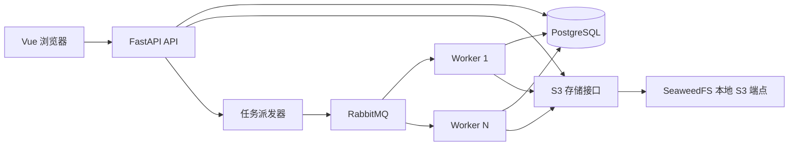

# 本地可靠性与规模验证详细设计（阶段 G）

| 属性 | 内容 |
|---|---|
| 文档编号 | DOC-DD-008 |
| 版本 / 状态 | 0.7 / 设计已评审；G0–G6 已交付（2026-10-03）。G6 只是同机合成基线，性能阈值仍未评审 |
| 日期 | 2026-10-03 |
| 依据 | `docs/03`、`docs/04`、`docs/06`、`docs/07`、`docs/08`、`docs/09`、`docs/12`、`docs/13`、`docs/14`、`docs/15`、`docs/16` |

## 1. 目的与阶段边界

本阶段为 DocPilot 建立可在单台 Windows 开发机上重复启动和验证的多进程开发环境，并补齐数据库、异步处理和文件存储的可靠性基础。Docker Compose 用于本机开发与集成测试；本阶段不部署线上服务器，不选择云厂商，也不把本地压测结果表述为生产容量承诺。

当前确认的长期容量规划目标：最多 100 个租户，文件总存储约 1TB，最多 100 个并发处理任务。它们是需要验证的产品目标，不代表当前实现已经满足。容量口径、峰值持续时间、任务类型构成、响应时间和恢复目标仍需后续基线化。

### 1.1 本阶段包含

- 使用 Docker Compose 启动 PostgreSQL、RabbitMQ、S3 兼容本地对象存储、API 和一个或多个 Worker。
- 让 PostgreSQL 成为此集成环境的数据库，验证 Alembic 迁移、模型约束和事务行为。
- 将处理任务执行移出 API 进程；增加任务派发、Worker 幂等领取、租约续期、超时回收及有界重试。
- 通过存储接口接入本地 S3 兼容服务，保持 `storage_key` 为相对对象键，不把绝对磁盘路径写入业务表。
- 让规范化提取结果成为读路径权威来源；盘点并迁移仍从 `processing_jobs.snapshot` 读取的接口。
- 增加本机数据库/对象数据备份恢复演练、迁移检查自动化、关键链路日志与压测方案。
- 为复核台和文档库加入浏览器端到端自动化测试。

### 1.2 本阶段不包含

- 云账号、线上主机、托管数据库或生产对象存储的采购与部署。
- 真实 1TB 数据集压测；当前 D 盘可用空间不足以承载该数据集。
- 生产 SLO、SLA、RPO/RTO、数据驻留区域、法规政策和最终文件保留期限的批准。
- Webhook、开放 API 密钥、计费、套餐或新的智能处理功能。
- 语义搜索、全文检索引擎替换或拆分微服务。

## 2. 容量规划口径

| 指标 | 规划值 | 当前口径/限制 |
|---|---:|---|
| 租户数 | ≤100 | 指同一部署中可用租户总数；需用合成数据验证数据库查询与授权边界 |
| 文件存储 | 约 1TB | 暂按原始上传文件逻辑总量理解；是否包含历史版本、派生文本、副本和备份待确认 |
| 并发处理 | ≤100 个任务 | 暂按同时执行的处理任务理解；排队任务不计入并发，持续时间和处理类型组成待确认 |
| 本地压测 | 以当前机器能力为限 | 当前环境约 20 个逻辑处理器、31.7GB 内存，D 盘约 118.5GB 可用；不模拟实际 1TB 文件驻留 |

容量测试应分别报告数据库/API 请求并发、队列积压、Worker 执行数、对象存储吞吐和 OCR/LLM 类型。用空处理器模拟 100 个并发任务只能验证调度与状态一致性，不能据此推断 100 个真实 OCR 任务的处理时延。

## 3. 推荐本地架构

Docker Compose 服务建议：

| 服务 | 责任 | 数据持久化 |
|---|---|---|
| `postgres` | 租户、任务、模板、结果、审计与派发状态 | 命名卷；提供健康检查 |
| `rabbitmq` | 至少一次任务消息传递 | 命名卷；持久队列/消息、发布确认和手动消费确认 |
| `object-store` | 提供 S3 兼容开发端点 | 命名卷；仅放测试文件，不作为生产存储选择 |
| `api` | 认证、授权、请求校验、事务写入和查询 | 无状态容器 |
| `worker` | 消费处理任务、运行解析/OCR/提取、写入规范化结果 | 可水平增加本地副本；状态落 PostgreSQL |
| `web`（可选） | 开发期 Vue/Vite 服务；也可继续由 API 托管构建产物 | 无状态容器 |

队列实现已在 G2 定案为 **RabbitMQ + pika 自建薄层**（原"建议采用 Celery"的偏离与理由见 `docs/adr/0004`）：RabbitMQ 只负责消息传递，`processing_jobs`、`job_attempts` 与新增的 `job_dispatches` 仍是业务状态权威来源，不使用任何框架自带结果后端作为业务结果库。Worker 消息只携带 `dispatch_id/job_id/tenant_id/attempt_no/queue`，不携带文件正文、令牌或绝对路径。进程入口为 `python -m app.dispatcher`（派发 + 超时回收 + 投递回收）与 `python -m app.worker`（领租约、续租、执行、同事务收口、手动 ack）；`BROKER_URL` 为空时保持 API 进程内执行，作为现有开发与用例基线。

对象存储本地实现暂建议 SeaweedFS 的单机 S3 端点，供 AWS S3 API 兼容性开发测试。MinIO 社区仓库在 2026-04-25 已归档，不作为新项目默认依赖。SeaweedFS 选型仅针对本机开发模拟器，不构成生产对象存储选型；S3 操作必须通过应用自己的 adapter 和兼容性测试。

G3 实机启动 SeaweedFS 4.22 时踩到的几处约束，已固化在 `docker-compose.yml`：该版本没有 `-smdir`（对象目录由 `-dir` 派生）；不要传 `-logdir`（glog 会因目录不存在反复退出，日志交给 stderr 由 Docker 收集）；`-ip` 必须是可回连地址，用 `0.0.0.0` 会让 master 客户端连 `0.0.0.0:9333` 失败，因此绑定所有网卡但自报 `127.0.0.1`，端口本身只发布到 `127.0.0.1`。另外端点在 `127.0.0.1` 时，环境里设了 `HTTP(S)_PROXY` 就必须让 `NO_PROXY` 覆盖 `127.0.0.1`，否则 boto3 请求会被系统代理拦下，表现为"存储不可用"。

## 4. 任务派发和执行设计

### 4.1 状态权威与可靠派发

1. API 在一个 PostgreSQL 事务中创建任务、文件关系、任务派发记录和领域事件；只有事务提交后，任务才对 Worker 可见。
2. 派发器以可重试方式领取待派发记录，向 RabbitMQ 发布持久消息并等待 publisher confirm，再记录已派发状态。
3. 若“消息已发布、数据库状态未更新”导致重复消息，Worker 通过 PostgreSQL 条件更新领取任务，确保同一租户任务只有一个有效执行租约。
4. Worker 在任务状态和尝试记录提交后才确认消息；执行时发生进程中断时消息可重投，任务租约超时后由恢复器重新排队或终结。
5. 处理结果、修订保护、任务终态和领域事件仍遵循现有数据库事务与幂等约束。不得把“消息已确认”当成“业务结果已持久化”。

不直接复用 `domain_events.published_at` 作为任务派发确认状态；该字段已有自动化消费语义（风险 R-014）。设计阶段应在专用派发表或独立消费者投递记录之间确定具体模型，并保证事件与业务写入原子提交。

### 4.2 Worker 租约

- 领取操作以数据库条件更新/行锁作为唯一并发判据，绑定 `tenant_id`、`job_id`、`attempt_id` 和随机租约令牌。
- Worker 周期性续租；续租必须匹配当前租约令牌和 `processing` 状态，旧 Worker 不得覆盖新尝试。
- 租约失效后，恢复器将尝试标记为超时；按 `JOB_MAX_ATTEMPTS` 决定重新入队或将任务置为 `failed`。
- 幂等约束继续由数据库唯一键、状态条件更新和规范化结果事务保证。OCR/LLM 可能重复调用，必须记录此限制并设置调用超时/预算。
- Worker 的 `prefetch`/并发数由环境变量限制；本地默认低于 100，100 作为调度压力测试目标而非默认开启的实际 OCR 并发。

## 5. 文件存储设计

- 定义 `ObjectStorage` 接口：上传流、读取流、删除、存在性/元信息查询；调用方传对象键，不自行拼接本机绝对路径。
- 保留 LocalFilesystem adapter 以兼容当前开发流程；新增 S3 adapter，集成测试指向 SeaweedFS S3 服务。
- 对象键使用随机标识并限制在租户命名空间内，不使用原始文件名；数据库继续保存相对 `storage_key`、校验和、媒体类型和字节数。
- 上传先将对象写入最终随机键，再提交数据库元数据和处理派发记录。数据库提交失败时尽力删除对象；若删除失败，由孤儿对象清理任务按“对象创建时间 + 数据库引用检查”补偿。
- 删除流程需要覆盖原文件、派生文本、搜索索引和导出缓存；备份副本清除依保留策略另行处理。彻底删除政策尚未批准，清理器在政策确认前不得自动清除真实数据。
- 下载始终经过租户授权后由服务端流式读取；未经评审不向浏览器暴露永久对象 URL 或存储凭据。
- 存量数据迁移：切换到 S3 adapter 前必须单独决策本机 `LocalFilesystem` 已写入的文件是回填到对象存储，还是作为可丢弃开发数据清零重建。回填需要一个按 `storage_key` 逐条复制、校验 SHA-256、并在数据库与对象两侧都可重跑的幂等工具；不回填则需提供干净的库/对象重置入口。二者都不得让 `storage_key` 的语义发生变化。

### 5.1 G3 落地后的实际契约

- `ObjectStorage` 最终方法集：`put` / `open_read` / `read_bytes` / `stat` / `delete` / `delete_prefix` / `list_keys` / `local_path`。元信息只返回存在性与字节数，任何方法都不返回本机路径。
- `local_path` 是给解析器（PyMuPDF、RapidOCR 只接受文件路径）的唯一出口：本地实现直接返回真实路径，对象存储实现落临时文件并在退出时删除。该路径禁止写入数据库、日志或响应。
- 上传按 `{tenant_id}/{job_id}/{uuid}.ext` 生成对象键，客户端文件名不参与寻址，因此"文件名里带 `..`"不再是攻击面；原始文件名单独存在 `document_versions.original_filename`。
- 数据库提交失败时按**任务前缀**整体回收对象（`delete_prefix`），而不是记住逐个键：部分写入失败与整批失败走同一条路径。前缀按层级段匹配，`tenant/job-1` 不会连带删掉 `tenant/job-10`。
- 补偿清理失败只记日志，不覆盖本次请求的真实原因；残留对象由 `scripts/storage_orphan_audit.py` 报告。该脚本**只报告不删除**——彻底删除政策（G-DEC-03）批准前不得自动清除真实数据；报告行只含 `tenant_id`/`job_id`/`version_id` 与对象键摘要，不含对象键与文件正文。
- 后端与存储根目录都在每次调用时从 `app.config` 读取，不在导入期固定：写入端与解析端必须看到同一个根，否则测试隔离了上传目录后 Worker 会去读一个不存在的位置。
- 存量文件按 G-DEC-07 走回填：`scripts/storage_backfill_to_object_store.py` 以 `document_versions.checksum` 为权威值，逐个对象复制后**读回比对摘要**，已存在且校验通过即跳过，只写不删源文件与记录，可中断重跑。
- 双方言与真实端点都实测出的契约差异：`list_keys(prefix)` 必须返回相对**存储根**的键，S3 实现最初返回相对查询前缀的键（少掉 `tenant/job`），只有指向真实 S3 端点的用例能抓到；SQLite/内存替身都会放过它。

## 6. 数据一致性与迁移

- PostgreSQL 上的 `processing_jobs`、`extraction_results`、`result_revisions` 等规范化表是新读路径的权威来源。
- 阶段 D 起 `extraction_results` 与快照同事务双写，但 `/result`、`/excel` 一直仍读快照，人工修订后这两个端点会退回机器值（风险 R-013）。G4（2026-10-03）把两者迁到规范化结果：与 `/export` 共用同一个"以 `extraction_results` 当前值为准"的读取函数，只有在任务没有任何规范化行时（阶段 D 之前的历史任务）才回落快照。`/excel` 同时不再复用 `excel_path` 缓存文件——缓存会让修订后的下载继续给出旧值，正是本阶段要消灭的不一致。快照列本身仍作为兼容期写入/回滚数据保留：`processing_jobs.snapshot` 还有仓库内读取者（`JobRepository.get()` 用快照重建 `Job` 的字段定义、进度、告警、`excel_path` 与遗留 `path`），因此移除列必须先让 `Job` 的构造也脱离快照，并按"记录迁移前备份 → 单独一个变更删列"的顺序推进。
- 开发 Compose 首次启动不应在 API lifespan 隐式执行迁移；建议以一次性 `migrate` 服务执行，API/Worker 等待迁移成功后启动。`app/main.py` 的 lifespan 仍会执行 `initialize_development_schema()`：应用容器化（G-DEC-08）本轮未做，该项随之顺延，不属于 G2/G4 已交付范围。
- 搜索索引、文件版本、任务和结果删除需保持租户范围和事务/补偿边界；跨租户外键与负向用例在 SQLite 和 PostgreSQL 都运行。
- PostgreSQL CI 门禁：空库 `upgrade head`、目标 revision 往返迁移、`alembic check`、模型约束测试；任何迁移失败不得进入镜像构建/发布阶段。
- G1 实测出的两类方言差异，G4（2026-10-03）已把三条残留项全部收口：
  - **NUL 字节**：PostgreSQL 的 text 与 json 一律拒绝 `\x00`，SQLite 照收。现在清洗收敛在 `app/services/text_safety.py`，覆盖四处入库边界——解析原文（`document_texts.text`，同时保证 `char_count` 与实际存储内容一致）、机器提取值与告警（`extraction_results`）、人工修订值、搜索索引内容。用例同时证明这些边界真的会收到脏数据（反向补丁会让用例失败）。
  - **时间戳序列化**：模型列声明为 `DateTime(timezone=True)`，SQLite 返回 naive、PostgreSQL 返回 tz-aware，同一端点在两种方言下给出两种形状。现在全部响应时间戳只经 `app/services/timestamps.iso_utc()` 输出 `...Z`（可原样回塞查询串，前端 `slice(0,10)`/`slice(0,16)` 的取法不受影响）。这条被写成两条用例：一条把所有租户 GET 端点的响应扫一遍（任何 ISO 形状的值都必须以 `Z` 结尾），一条对 `app/` 做 AST 扫描，禁止再出现手写 `.isoformat()`（豁免 `timestamps.py` 自身与把 `date` 格式化成 `YYYY-MM-DD` 的提取层）。
  - **无 `ORDER BY` 的查询顺序**：SQLite 按插入顺序返回、PostgreSQL 不保证顺序。G1 AST 扫出的 10 个无 `order_by` 函数里，只有 `app/contexts/operations/service.py` 的 `_grouped`/`_by_tenant` 会把行装配成 dict 进而影响响应 JSON 键序；两处现在都显式 `order_by(value.is_(None), value)`（先比 `IS NULL` 再比值，绕开两方言对 NULL 默认排序方向的差异），并由 `tests/test_dialect_residue.py` 断言排序确实下推到 SQL。其余 8 处是聚合或单行查找，语义与顺序无关。
  - **诚实记录一处不证明力的断言**：`test_operations_aggregates_keep_a_stable_key_order` 断言响应键序等于排序结果，但在去掉 `ORDER BY` 后仍然通过——PG 在该数据集上走了索引扫描，恰好返回有序行。真正把关的是上面那条 SQL 结构断言；保留行为用例是为了钉住契约形状，不夸大它的判别力。

## 7. 本地备份、恢复和安全

- 破坏性脚本只能作用于显式命名的一次性库。`app/db.assert_disposable_database()` 要求库名匹配 `<名称>_test` 或 `test_<名称>`——"名字里含 test"的子串判断会放过 `latest` 这类真实业务库名，不可用于清库路径。恢复演练的隔离库默认带运行标识、名称必须匹配 `^docpilot_drill_[A-Za-z0-9_.-]+$`，目标库已存在即拒绝运行，且只删除本次自己创建的库；存在性查询失败必须中止，不能把"查不到"当成"不存在"。
- 编写 PostgreSQL `pg_dump`/`pg_restore` 与对象卷快照的本地演练步骤；恢复后核对文档版本、存储键、校验和、任务状态和索引引用。
- 该演练只证明本地操作脚本和恢复核对可运行，不代表异机灾备或生产 RPO/RTO 达标。
- Compose 只绑定开发所需的本机端口；数据库、RabbitMQ 管理端点和对象存储管理端点不对局域网/公网开放。
- 开发凭据放在未提交的 `.env`；仓库仅提供 `.env.example`，不得提交可用于线上环境的密钥。
- 日志应包含 `request_id`、`tenant_id`、`job_id`、`attempt_id`，不得包含文件正文、访问令牌、数据库连接串或对象存储密钥。

## 8. 实施顺序与阶段门

| 子阶段 | 交付 | 进入下一步条件 |
|---|---|---|
| G0 需求/环境基线 **已完成** | 本文评审、Docker Desktop/WSL2 可用、容量口径和待决项登记 | 设计评审通过；本机 Compose 可启动基础依赖 |
| G1 PostgreSQL 与质量门禁 **已完成** | Compose、Alembic CI、PostgreSQL 集成测试、迁移和本地备份恢复脚本 | PostgreSQL 测试通过，迁移门禁可重复运行 |
| G2 队列与 Worker **已完成** | RabbitMQ、派发器、独立 Worker、租约/恢复/幂等 | Worker 崩溃、重复消息、broker 故障用例通过 |
| G3 S3 对象存储 adapter **已完成** | LocalFilesystem/S3 adapter、SeaweedFS Compose、孤儿补偿设计 | 上传/读取/删除/校验和/越权用例通过 |
| G4 结果权威源和生命周期 **已完成** | 剩余快照消费者切换、索引/派生数据清理策略、可回滚迁移 | 无旧读路径消费者；一致性与兼容性用例通过 |
| G5 管理界面和 E2E **已完成** | 模板、成员/邀请、事件规则界面；复核/文档库 Playwright | 核心 UI 流程端到端通过（10 条用例，2026-10-03）。**原口径"干净 Compose 环境"未满足**：实际是一次性本地进程（独立端口 + 独立 SQLite + 独立上传/输出目录），见 G-DEC-12 |
| G6 容量观测 **已完成（2026-10-03）** | 可重复的合成数据观测脚本与报告（`scripts/capacity_observation.py` → `docs/18`） | 报告覆盖租户数、任务并发、队列延迟、内存与磁盘及失败率；**CPU 未报**（观测进程、Worker 与数据库同机混跑，采样无法归因）。数字只是同机合成基线，不构成容量结论 |

阶段 F 中”先拆 Worker”与”先验证 PostgreSQL/迁移”顺序调整为先 G1 后 G2，避免 Worker 建立在未验证的数据库行为之上。此顺序不要求上线服务器。

G4 的出口条件按字面只完成了一半，另半场单独记下：结果读路径（`/result`、`/excel`）已无快照消费者，但 `processing_jobs.snapshot` 列仍被 `JobRepository.get()` 读取用于重建 `Job`，因此列本身未退役、迁移前备份也未必要做；把”无旧读路径消费者”理解为”业务结果不再有第二个真相源”是准确的，理解为”仓库已无任何快照读取者”则不成立。

## 9. 验收测试设计

| 用例 | 场景 | 预期 |
|---|---|---|
| TC-OPS-010 | 干净克隆按文档启动 Compose | 依赖健康检查通过，迁移只执行一次，API/Worker Ready |
| TC-REC-008 | PostgreSQL 空库及上一 revision 迁移 | upgrade/downgrade/upgrade 与 `alembic check` 成功，无模型漂移 |
| TC-REC-009 | 发布确认前后杀死派发器/Worker | 任务最终被处理或进入明确失败状态，不静默丢失；重复发布不重复产生业务结果 |
| TC-REC-010 | Worker 执行时强制退出并让租约过期 | 尝试可诊断、旧 Worker 不能提交、在有界次数内恢复 |
| TC-REC-011 | RabbitMQ 重启、断连、重复投递 | API 持久化任务仍存在；broker 恢复后可派发；重复投递安全 |
| TC-DATA-002 | 对象上传、读取、删除、校验和及数据库写失败补偿 | 租户隔离正确；无绝对路径泄露；孤儿对象可被识别/补偿 |
| TC-REC-012 | PostgreSQL 和对象数据备份后恢复到隔离卷 | 文档引用、SHA-256、规范化结果与任务状态核对一致 |
| TC-PERF-001 | 100 个合成租户、租户隔离查询 | 报告查询时延和错误率；不出现跨租户结果 |
| TC-PERF-002 | 100 个模拟处理任务并发调度 | 报告队列等待、Worker 吞吐、失败和资源占用；模拟任务结果与数据库事实一致 |
| TC-PERF-003 | 大对象/分页导出压力检查 | 请求流式处理；内存占用不随总文件量线性增长；本地测试不要求实际生成 1TB 文件 |
| TC-E2E-001 | 登录→上传→处理→复核→确认→搜索→导出 | 浏览器流程通过，授权角色与后端结果一致 |

性能验收阈值（P95 时延、吞吐、持续时间、OCR 文档构成、CPU/内存限额）须在负载模型设计后另行确认。没有阈值前，压测只形成测量基线，不得写“支持 100 并发/1TB”。

## 10. 未决事项

| ID | 未决项 | 当前处理 |
|---|---|---|
| G-DEC-01 | 1TB 是否包含文件历史版本、派生文本、备份与副本 | 暂按原始上传对象逻辑容量记录，评审确认 |
| G-DEC-02 | “100 个并发处理任务”的任务类型、活跃定义与持续时间 | 暂按同时运行的 Worker 任务；实际 OCR 并发需基准测试 |
| G-DEC-03 | 客户地域、法规、加密与留存/删除期限 | 线上部署前必须批准；本阶段不自动彻底删除 |
| G-DEC-04 | 生产 PostgreSQL、队列和对象存储供应商/拓扑 | 本地 Compose 不预设生产供应商 |
| G-DEC-05 | SLO、RPO/RTO、备份周期与恢复窗口 | 需业务方给值后作为正式发布门槛 |
| G-DEC-06 | 本机容器环境安装状态 | **已解决（2026-10-03）**：未安装 Docker Desktop；改用 WSL Ubuntu-24.04 内的 Docker Engine 29.8.2 + Compose v5.6.0，`networkingMode=mirrored` 才能让本机代理生效。`docker` CLI 仅存在于 WSL，Windows 侧无 |
| G-DEC-08 | 应用与 Worker 是否容器化 | G1 只容器化基础设施（postgres），API/Worker 仍在 Windows 侧 `.venv` 运行；容器化时机随 G2 派发器与 `migrate` 服务一并评审 |
| G-DEC-09 | 队列模式下的就绪判定 | **已解决（2026-10-03，G5 第一部分）**：`/readyz` 新增 `queue` 段并在队列模式下参与判定。口径分三种——未设置 `BROKER_URL` 时进程内执行，队列不参与判定；队列模式下问不到 broker（`consumers` 为 `null`）一律不就绪，因为配置声称走队列却连状态都取不到；问到消费者数时，只有"有积压且消费者为 0"才算卡住，没活时 0 个消费者是正常缩容。消费者数由 `passive=True` 的队列查询得到，探针不会创建队列，配置写错队列名不会被掩盖。真实 broker 侧由 `tests/test_queue_broker.py::test_consumer_count_reads_the_real_queue` 校验 |
| G-DEC-07 | 存量 `LocalFilesystem` 文件是回填对象存储还是清零重建 | **已解决（2026-10-03）**：走回填，不重置开发数据。交付 `scripts/storage_backfill_to_object_store.py`——按 `document_versions.checksum` 逐条复制、上传后读回比对摘要、已存在且校验通过即跳过、只写不删，因此可中断重跑；源目录与数据库都不改动，失败最多是"还没迁完" |
| G-DEC-10 | 默认对象存储后端与切换步骤 | `STORAGE_BACKEND` 默认仍为 `local`，即 G3 之后的开发基线没有改变；切到 `s3` 的顺序是"起 Compose（含 `object-store`）→ 配 `S3_*` → 跑回填并确认退出码 0 → 再改 `STORAGE_BACKEND=s3`"。回填未通过前切换会让已上传的文档读不到 |
| G-DEC-11 | 对象卷的备份恢复演练 | **演练已交付，但结论受限（2026-10-03，G7）**：交付 `scripts/object_store_backup_drill.py`。源容器 `pause` 期间用一次性 alpine 容器把 `object-store-data` 卷复制成冷副本，再把副本挂到独立实例（`127.0.0.1:18333`）按 S3 语义核对键集合、对象大小与 SHA-256；三类破坏注入（删除整个对象、等长改写 1 字节、截断 1 字节）分别证明键集合、尺寸、摘要三道检查互不替代，改写后重建副本复跑正向一致，探测对象与恢复容器全部回收，`DRILL RESULT: PASS`（TC-REC-013）。11 次运行里 10 次 `PASS`、1 次在「重建副本复跑」阶段失败（那次的输出被过滤掉，没留下失败签名，根因未知）。因此这条演练能签的是「我们有能力发现某次备份不可恢复」，**不是**「对象数据已有可恢复备份」。要让后者成立，备份流程必须自带恢复后全量摘要核对（或改逻辑级对象复制 / SeaweedFS 原生复制），见 `docs/19 §3.3`。 首轮结论是 **CHECK 而非 PASS**：校验器原先"尺寸相等才比摘要"，把 5 MB 对象换成 17 字节的改写同时躲过两道检查，已改为尺寸与摘要各自独立判定。不属于本演练：生产备份设施与周期、增量备份、跨机灾备、保留策略、恢复时间目标（G-DEC-05） |
| G-DEC-12 | 端到端用例的运行环境 | G5（2026-10-03）选择**一次性本地进程**而不是 §8 原写的"干净 Compose 环境"：`frontend/tests/global-setup.ts` 起独立端口的一次性后端（独立 SQLite + 独立上传/输出目录，全在被忽略版本控制的 `data/e2e/`）与 Vite dev server，代理目标经 `DOCPILOT_API_ORIGIN` 注入。理由有两条：一是复用已在 `:8000` 的后端会把测试写进真实开发数据，因此端口被占用时 setup 直接失败而不是退回那条路径；二是 Compose 栈会同时带来队列与对象存储，端到端要断言的是 UI 契约，把两者留成 `BROKER_URL=''` + `STORAGE_BACKEND=local` 的基线更稳定。代价如实记录："核心 UI 流程可在干净 Compose 环境端到端通过"这条进入下一步条件已在 G8（2026-10-03）补上证明：`E2E_COMPOSE=1` 让同一套 10 条用例跑在 Compose 依赖栈上——PostgreSQL 一次性库 `docpilot_e2e_test`、RabbitMQ 本次专用队列、SeaweedFS 的 `e2e-<run>/` 前缀，API / 派发器 / Worker 是三个独立进程，且 setup 以 `/readyz` 报出"队列已启用且 consumers ≥ 1"为起步门槛（只看 `/healthz` 不够：没积压时 0 消费者也算就绪）。一次性本地进程形态保留为默认基线。这一轮顺带抓出并修掉一处派发租约竞态（`docs/06 §5.17`）。仍未证明的是应用与 Worker 的容器化，属 G-DEC-08 |

## 11. 技术参考

- Celery 晚确认模式要求任务具备幂等性：<https://docs.celeryq.dev/en/stable/userguide/optimizing.html>
- RabbitMQ 的持久消息、发布确认和消费者确认：<https://www.rabbitmq.com/docs/confirms>、<https://www.rabbitmq.com/docs/reliability>
- SeaweedFS 项目提供 Docker/Compose 与 S3 端点：<https://github.com/seaweedfs/seaweedfs>
- MinIO 社区仓库已归档，评审本设计日期所见状态：<https://github.com/minio/minio>
- Windows Docker Desktop/WSL2 环境要求：<https://docs.docker.com/desktop/setup/install/windows-install/>
